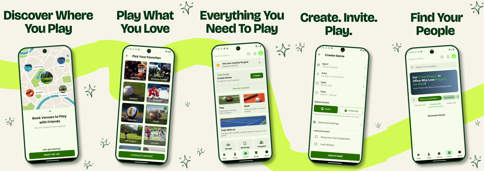

<h1 align="center">🏀 Sporto</h1>
<p align="center">

</p>

### Discover • Play • Train • Connect

## Overview
Sporto is a Flutter application that helps users discover games, book venues, connect with players, and train with professional coaches through one seamless experience.

## Features
### Play
- Discover & join games
- Create private/public matches
- Invite and manage players

### Book
- Search venues
- Check court availability
- Book time slots

### Train
- Find verified coaches
- Ratings & reviews

### Profile
- Sports preferences
- Booking history
- Rewards

### Authentication
- Phone OTP
- Email OTP
- Google Sign-In


## Tech Stack
- Flutter
- Dart
- Riverpod
- Supabase
- SQLite
- GetIt

## Folder Structure

```text
lib/
├── core/
├── features/
├── services/
├── widgets/
└── main.dart

assets/
├── fonts/
├── images/
└── logos/
```

## Installation

```bash
flutter pub get
flutter run
```

Create `.env`

```env
SUPABASE_URL=your_url
SUPABASE_ANON_KEY=your_key
```

## Architecture

Presentation
↓
Riverpod
↓
Repository
↓
Services
↓
Supabase + SQLite

## Roadmap
- Team Management
- Chat
- Notifications
- Tournament Support

## Contributing
Fork → Branch → Commit → PR

## Support
If you like the project, please give it a .

